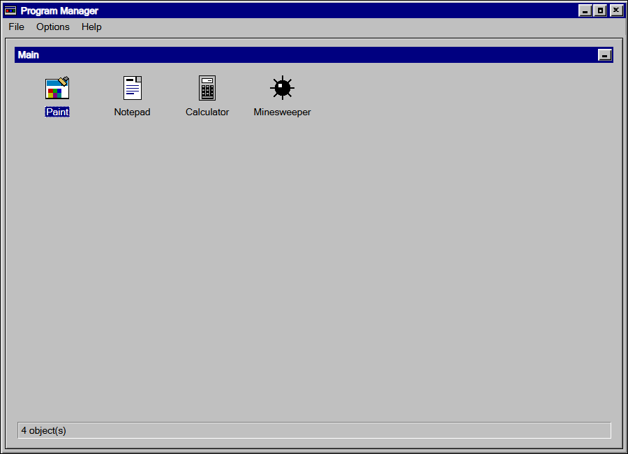
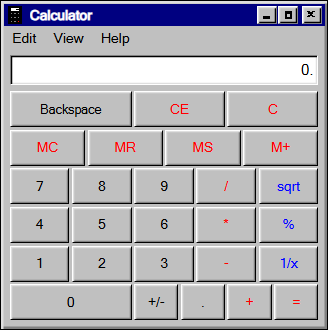
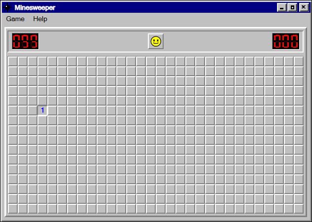
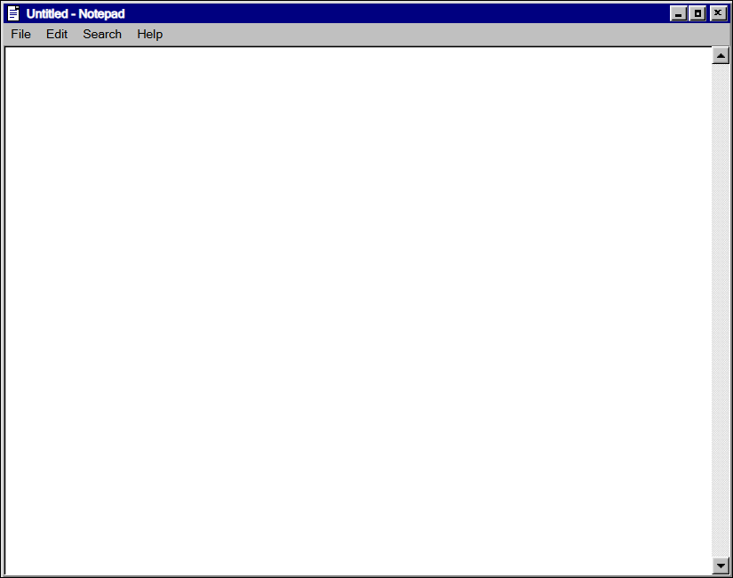

# Win9x Suite

Four classic Windows apps and a Program Manager launcher — rebuilt as real desktop windows.

Paint, Notepad, Calculator and Minesweeper, in one 324 KB executable. No installer, no Electron,
no framework — it renders in the WebView2 runtime that already ships with Windows.



## What's in it

Double-click the launcher, pick an app, or start one directly (`Win9x-Suite.exe` here is the
version-stamped file from the release):

```
Win9x-Suite.exe                Program Manager
Win9x-Suite.exe paint          Paint
Win9x-Suite.exe notepad        Notepad
Win9x-Suite.exe calc           Calculator
Win9x-Suite.exe minesweeper    Minesweeper
```

**Program Manager** — the 1995 launcher, with its Main group, pixel-art icons, Minimize button,
"4 object(s)" status line and a menu bar that actually opens.

**Paint** (Windows 95) — pencil, brush, eraser, fill, line, rectangle, ellipse, polygon and text;
the two-row tool palette; undo; copy/paste against the real Windows clipboard; 256-colour bitmap
and PNG save through a real Save As dialog.

**Notepad** (Windows 98) — open, save and save-as on real files, word wrap, the font dialog,
find, time/date insert, and printing through the real print dialog with `&f`/`&p` header and
footer tokens.

**Calculator** (Windows 98) — the standard view: 27 keys, red operator and memory keys, blue
`sqrt` / `%` / `1/x`, memory with an M box, keyboard support, digit grouping, a 15-digit limit,
percent relative to the left operand, and repeat-equals on Enter. Scientific is listed in the
View menu and greyed out rather than faked.

**Minesweeper** (Windows 98) — Beginner, Intermediate, Expert and Custom; first click always
opens a clear area; right-click cycles flag → question → blank; chord by clicking a numbered
square; the smiley reacts; the window resizes to the board; best times per level; monochrome
mode; F2 for a new game, F1 for help.





## Why it looks right

**There is only one title bar, and it's the real one.** Each app is a frameless native window
that draws the Windows 95 caption inside the page, so dragging the drawn title bar drags the
actual window, and minimise / maximise / close are the real system buttons. No fake chrome
stacked under real chrome.

**Every app is its own process.** The launcher starts descendants of itself, so each window gets
its own real taskbar entry — like 1995, and unlike a single-window app switcher.

**The pages are plain web files served from disk** under a virtual `https://win9x.local` origin
inside an embedded Chromium control (WebView2). Modules, `fetch` and normal same-origin rules
work, with no local server running. Files, clipboard and printing go through the native host over
a small JSON message bridge, so Notepad saves real `.txt` files and Paint saves real images.

**Pixel-exact furniture.** Icons, toolbar glyphs and the seven-segment displays are inline SVG
with crisp edges; no image assets, no icon font, no webfonts. Sizes follow the monitor's DPI
scale, so it stays sharp at 100%, 125% or 150%.

## Download

Grab `Win9x-Suite-x.y.z.exe` from the [latest release](../../releases/latest) and run it. It
unpacks itself into `%LOCALAPPDATA%\Win9xSuite\app` on first launch and starts from there; there
is nothing to install, no admin prompt, and no registry changes. Delete the exe and that folder to
remove it.

The same release ships a portable folder and a zip if you would rather not run a self-extracting
exe.

**Requirements:** Windows 10 or 11, 64-bit, and the Microsoft Edge WebView2 runtime. Windows 11
ships with it; on Windows 10 it arrives with Edge, and there is an installer on Microsoft's site
if a window ever says the rendering engine could not start.

The build is unsigned, so SmartScreen may ask once — "More info" → "Run anyway".

## Build it yourself

You need Windows with the .NET Framework (the compiler that ships with it is enough — no Visual
Studio, no .NET SDK), plus Node.js for the tooling.

```bash
bash shell/build.sh     # compiles shell/bin/Win9x.exe with csc.exe
npm run package         # stages the release folder, zip and single exe
npm start               # optional: serve the pages at http://localhost:8135
```

`shell/build.sh` pulls the WebView2 managed DLLs from NuGet once into `shell/lib` on the first
run. There is no `npm install` step: the project has no dependencies.

## Checks

Each app is verified by a headless-Chrome harness that drives the page over the DevTools protocol
and asserts on real behaviour — no test framework, no Playwright.

```bash
npm run check              # Paint, 25 checks
npm run check:notepad      # Notepad, 18 checks
npm run check:calc         # Calculator, 28 checks
npm run check:minesweeper  # Minesweeper, 34 checks
```

105 checks in total. They cover pixel geometry, keyboard handling, save/print plumbing, timer
behaviour and the tricky Minesweeper rules (first-click safety, chording, win detection).

## Layout

```
index.html, launcher.js, launcher.css   Program Manager
apps/paint, apps/notepad,               the four apps (one folder each:
apps/calc, apps/minesweeper             markup, styles, logic)
chrome/                                 shared Win95 chrome: styles, menu
                                        bar, dialogs, window glue
shell/                                  native host (C#) and its build
tools/                                  checks and the packaging script
```

## Notes and limits

- Two copies of the *same* app cannot run at once — that's deliberate. Different apps can.
- Calculator is the standard view only; Notepad supports `&f` and `&p` in headers, not the full
  set of Windows 98 tokens.
- At 150% scaling some toolbar glyphs are upscaled rather than redrawn.
- Settings, best times and window data live in `%LOCALAPPDATA%\Win9xSuite`.

## Disclaimer

A fan recreation for nostalgia, not a port. Not affiliated with, endorsed by or connected to
Microsoft. Windows, Windows 95 and Windows 98 are trademarks of Microsoft Corporation.
